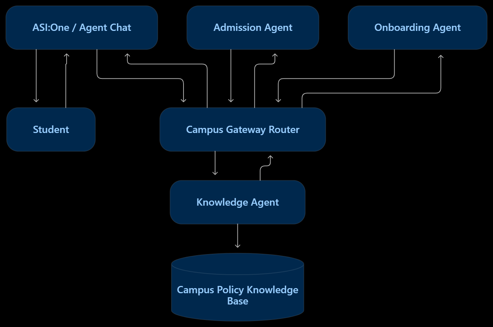

# CampusFlow-Mesh
### A Multi-Agent AI Assistant for Campus Services

CampusFlow-Mesh is a multi-agent campus assistance system designed to help students access campus information, understand admission requirements, and complete common onboarding tasks through a conversational interface.

## Problem Statement

Students often need to navigate different sources to find campus policies, admission information, and administrative procedures. CampusFlow-Mesh aims to make this information easier to access through a unified AI-powered interface.

## Our Solution

CampusFlow-Mesh uses specialized AI agents coordinated by a central router to handle different types of campus requests.

## System Architecture

- **Gateway Router:** Receives user messages and directs requests to the appropriate agent.
- **Admission Agent:** Handles admission-related queries.
- **Onboarding Agent:** Supports student onboarding workflows.
- **Knowledge Agent:** Retrieves relevant information from the campus policy knowledge base.

## Technology Stack

- Python
- Fetch.ai uAgents
- Agentverse
- Agent Chat Protocol
- Cloudflare Tunnel for temporary public testing

## How It Works

1. A student submits a question.
2. The Gateway Router receives the request.
3. The router forwards it to a specialized agent.
4. The selected agent processes the request using the available knowledge or workflow.
5. The response is intended to return through the router to the student.

## Current Implementation

- Multi-agent architecture configured.
- Router registered and activated in Agentverse.
- Local server and public endpoint tested.
- Automated Agentverse tests have recorded a passing result.
- End-to-end public chat reliability is still being investigated.

## Responsible Use

This project is a prototype for demonstration and educational purposes. Its policy data is not an official source of institutional rules. Students should verify important admission and administrative requirements with the relevant college department.

Users should not submit passwords, private credentials, or sensitive identity documents to this demo.

## Run Locally

1. Install Python and create a virtual environment.
2. Install the dependencies listed in `requirements.txt`.
3. Configure the required environment variables in `.env`.
4. Start the multi-agent application:

   `python campus_mesh.py`

Keep API keys, seed phrases, and other secrets out of GitHub.

## Future Improvements

- Improve end-to-end chat reliability.
- Expand and verify the campus knowledge base.
- Add more campus-service workflows.
- Improve monitoring, error handling, and deployment reliability.

## Project Status

Hackathon prototype — core agent architecture implemented; public end-to-end chat requires further validation.
